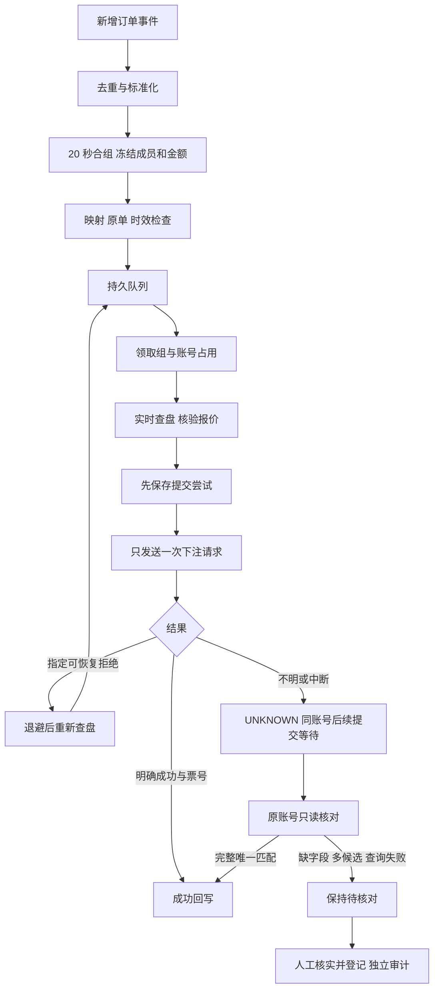

# 跟单执行与结果核对

本模块把已采集的 PS38 新单，经 20 秒持久化合组、已确认赛事映射和皇冠盘口核验，交给后台队列执行，再把结果写回原订单组。运行时使用本项目的订单库、映射库、账号池和独立跟单任务库，不依赖 `hdproc`。

当前范围是一条全局规则、一个皇冠会员账号、滚球足球单关的全场／上半场让球和大小。金额按人民币计算，PS38 的 THB／RMB／CNY 标签均保留原数字，不换汇。多账号拆分、赛前和特殊玩法不在本期范围。

## 使用页面

1. 在“号池管理”完成皇冠会员登录，确认账号在线；在“赛事合并”保存目标赛事的绑定关系。
2. 打开 `#/copy`，展开跟单规则，设置正向／反向、固定金额／百分比、源会员范围、目标账号及原单最长时效，保存后启用。
3. 新组收集 20 秒后冻结。切换到“处理中”查看排队、查盘、退避等待或提交进度；展开明细查看原单、尝试、状态历史及核对审计。
4. 出现“待核对”时先检查原请求。页面可安排一次只读核对；仍不能确认时，人工到平台核对后登记成功或未成交结果。成功需要有效票号，核对依据必须填写，实际金额和水位可留空。

首次启用及暂停后重新启用，从当前新增事件位置开始，不补跟停用期间的订单。暂停会终止尚未提交的组；已发出的请求继续保存返回，已有未知结果继续只读核对。人工核对“未成交”只结束该组，不重新跟单。

## 执行链路

调度线程持续消费和合组。网络查盘、提交、只读核对运行在固定大小执行器中；同账号同时最多一个网络任务，没有空位时组留在数据库等待。数据库的账号唯一占用同时保护多个服务实例，不靠页面轮询实现排队。

## 状态和处理方式

| 状态 | 页面含义 | 系统后续行为 |
| --- | --- | --- |
| `GROUPING` | 合组中 | 收集源时间固定 20 秒窗口内的同条件原单 |
| `WAIT_MAPPING` | 等待映射 | 有期限重新检查已保存绑定 |
| `READY` | 已冻结、等待执行 | 等待执行名额或同账号未知结果解除 |
| `PREPARING` | 核验盘口中 | 原账号只读查盘，检查报价、金额和比分 |
| `WAIT_MARKET` | 暂缺盘口或查盘失败 | 退避重查，受次数及源单期限限制 |
| `RETRY_WAIT` | 明确可恢复失败，等待重查 | 冻结内容不变，重新准备新报价 |
| `SUBMITTING` | 提交在途 | 已保存尝试，等待一次写请求的结果 |
| `UNKNOWN` | 待核对 | 仅核对原请求，同账号后续提交等待 |
| `SUCCEEDED` | 已确认成功 | 保存唯一票号；人工登记显示人工核对来源 |
| `REJECTED` | 明确拒绝或人工确认未成交 | 结束；不可恢复原因不自动重做 |
| `EXPIRED`／`SKIPPED` | 已过期或跳过 | 保存原因，不补跟 |

等待原因、查盘次数、重试次数、核对次数和下次动作时间帮助区分“仍在处理”和“需要人工核对”。下次动作时间是调度条件；账号仍占用或网络未返回时，实际执行可能更晚。

## 重试边界

查盘阶段没有发送下注请求。一般网络、响应格式和会话暂不可用错误最多累计 6 次，退避约 3、6、12、15 秒；缺盘、封盘、盘口变化按同样退避等待，始终受原单最长时效限制。身份冲突、多匹配、比分变化及无效字段等不可恢复问题直接结束。

提交阶段只允许两类情况重新查盘：平台明确拒绝、没有票号，且错误为 `1X001`、`1X003`、`1X015`、`1X016` 或 `doubleLogin`；或者适配器明确证明写请求未发送，且错误为报价过期、会话变化或准备预算超时。所有情况还需适配器明确标记可重试。组最多保留 3 次提交尝试，前两次退避 2、4 秒。规则暂停、源单过期或重试耗尽时结束等待。

冻结后的成员、金额和规则版本在重试中不变。每次重新准备都使用新报价，发送前再次检查原单、映射、金额、报价时效与停止信号。平台写请求没有传输层自动重发。网络超时、未知响应及程序在提交期间退出均不能证明未成交，因此进入 `UNKNOWN`。

## 只读核对和人工登记

自动核对固定使用原账号查询今日注单，最多 5 次、120 秒。查询必须明确成功且返回完整集合；只有账号、球种、滚球、比赛及实际盘口 ID、时段、玩法、方向、带符号盘口、人民币金额、时间和有效票号均吻合，并且候选唯一，才回写成功。空集合不能证明未成交，多候选不能直接取最近一票。

自动核对耗尽后保持待核对。页面“只读核对”可以再安排一次查询，不发送下注请求。真实站点若使用尚未确认的字段、分页或文本格式，系统也保留待核对；需要通过脱敏样本补充解析兼容，不能降低匹配条件。

人工登记仅限没有在途占用的 `UNKNOWN` 组。成功必须填写合法票号，票号在同账号下不可关联两个组；核对依据为 3–500 字。实际金额／水位不填写就保留为空，不用原提交数值冒充成交数据。登记结果保存 `receipt_source=manual` 和独立审计，迟到回执不能覆盖人工终态。此操作应在平台核实后使用。

## 停止与重启

正常停止会阻止新任务，向适配器传递停止信号，并有界等待在途任务。底层 DNS、连接或响应头处理可能超出等待预算，超时不表示请求已退出，不删除仍存活的占用。再次启动前先回收已完成任务；仍有在途任务时提示等待。

重新启动只回收确认失效的占用：准备阶段恢复待查盘；提交阶段转为待核对；只读核对阶段恢复查询调度并保留原次数与期限。已完成、已跳过和未知组不会被重新下注。源事件有缺口时暂停消费，显示原因，不自动重放历史订单。

## 接口与维护

| 接口 | 用途 |
| --- | --- |
| `GET /api/follow` | 规则、统计、服务状态、执行／等待数量和组列表 |
| `GET /api/follow/groups/<id>` | 原单、提交尝试、状态历史和核对审计 |
| `POST /api/follow/rule` | 保存规则 |
| `POST /api/follow/pause` | 暂停新处理 |
| `POST /api/follow/groups/<id>/reconcile` | 安排一次只读核对 |
| `POST /api/follow/groups/<id>/resolution` | 登记已人工核实的未知结果 |

人工登记请求字段为 `outcome`（`SUCCEEDED`／`REJECTED`）、`receipt_id`、`note`，可选 `accepted_stake`、`accepted_odds`。查询明细中的 `history` 记录状态变化，`reconciliations` 中的 `method` 区分 `automatic`、`requested` 和 `manual`；`receipt_source` 用 `platform`、`platform_query` 和 `manual` 区分即时回执、平台查询及人工登记。核对查询不覆盖原提交尝试的发送记录。没有重新提交未知组的接口。

本地验收使用临时数据库、模拟平台与本地 HTTP 服务，运行 `python scripts/check.py` 和 `python scripts/check.py --browser`。这些测试验证状态与请求次数，不等同于真实站点成交验证。开发约定见 [DEVELOPMENT.md](DEVELOPMENT.md)，设计依据见 [FOLLOW_SYSTEM_DESIGN.md](FOLLOW_SYSTEM_DESIGN.md)。
