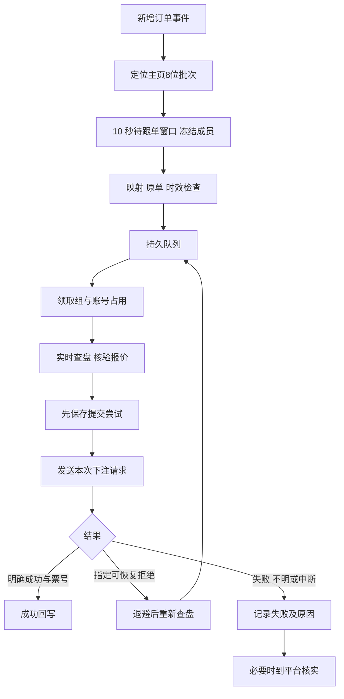

# 跟单执行与结果记录

本模块把已采集的 PS38 新单按主页「跟单视角」生成的 20 秒展示批次归组：该批次首单进入服务时开启固定 10 秒待跟单窗口，窗口内同批次订单并入但不重置倒计时；满 10 秒冻结成员与合计金额并分配独立跟单批次号，再经已确认赛事映射和皇冠盘口核验后交给后台队列执行。冻结后到达的订单进入下一批重新计时，已处理源单按订单键去重，不会重复跟单。窗口截止时间与成员持久化，重启后按原截止时间恢复。运行时使用本项目的订单库、映射库、账号池和独立跟单任务库，不依赖 `hdproc`。

当前范围是一条全局规则、号池自动分配皇冠会员、足球单关的全场／上半场让球和大小。`follow_allow_prematch` 默认开启，关闭后只处理滚球。每个组使用一个账号，可按规则分为 1–50 份顺序提交，并设置 0–60 秒间隔；份数会按最低投注金额约束缩减。金额按人民币计算，比例金额向上取整为整元，PS38 的 THB／RMB／CNY 标签均保留原数字，不换汇。同组跨账号分单和特殊玩法尚未实现。

## 使用页面

1. 在“号池管理”完成皇冠会员登录并启用账号，确认账号在线、会话有效；在“赛事合并”保存目标赛事的绑定关系。
2. 打开 `#/copy`，点击“跟单规则”进入设置页，设置正向／反向、固定金额／百分比、分单、限额、源会员范围及原单最长时效，保存后启用。执行账号由服务从可用号池自动轮转分配，无需在规则中选择会员。
3. 主页批次首单进入跟单服务后进入 10 秒待跟单窗口，窗口内同批次新单并入但不延长倒计时；满 10 秒冻结并排队。切换到“处理中”查看排队、查盘、退避等待或提交进度；展开明细查看冻结成员中的原单、尝试、状态历史及分单结果。冻结后到达的同批次订单会进入下一批，不会追加到已建跟单记录。
4. 对失败或部分成功的记录，展开明细检查每次尝试与票号。响应不明、平台处理中但未取得票号或程序在提交期间中断时，组也会记为失败；应到平台核实，不能据此断定未成交。当前没有只读核对或人工登记入口。

首次启用及暂停后重新启用，从当前新增事件位置开始，不补跟停用期间的订单。暂停会终止尚未提交的组并作废未冻结的待跟单窗口；已发出的请求继续保存返回。旧版未知组保留原记录，不自动查询或重发。

## 执行链路

调度线程持续消费新批次。网络查盘和提交运行在固定大小执行器中；同账号同时最多一个网络任务。服务只从启用、在线且会话有效的皇冠会员中选择账号，按持久化游标轮转并优先使用本组尚未尝试过的账号；账号不可用或全部忙时组以 `WAIT_ACCOUNT` 留在数据库等待，不靠页面轮询实现排队。数据库的账号唯一占用同时保护多个服务实例。

## 状态和处理方式

| 状态 | 页面含义 | 系统后续行为 |
| --- | --- | --- |
| `GROUPING` | 旧版任务 | 新版不再创建；无在途请求的旧待处理组启动后会结束，不再提交 |
| `WAIT_MAPPING` | 等待映射 | 有期限重新检查已保存绑定 |
| `READY` | 已冻结、等待执行 | 等待执行名额与可用账号 |
| `WAIT_ACCOUNT` | 等待可用账号 | 账号恢复或空闲后自动分配，不要求人工选号 |
| `PREPARING` | 核验盘口中 | 原账号只读查盘，检查报价、金额和比分 |
| `WAIT_MARKET` | 暂缺盘口或查盘失败 | 退避重查，受次数及源单期限限制 |
| `RETRY_WAIT` | 明确可恢复失败，等待重查 | 冻结内容不变，重新准备新报价 |
| `SUBMITTING` | 提交在途 | 已保存尝试，等待一次写请求的结果 |
| `UNKNOWN` | 旧版未知结果 | 兼容保留，不自动查询或重发，不阻塞账号后续组 |
| `SUCCEEDED` | 平台回执成功 | 保存票号；分单须全部成功 |
| `PARTIAL` | 分单部分成功 | 保存已成功的票号与逐份结果，不整组重发 |
| `REJECTED` | 未取得有效成功回执 | 保存拒绝、响应不明或中断原因；失败不能证明未成交 |
| `EXPIRED`／`SKIPPED` | 已过期或跳过 | 保存原因，不补跟 |

等待原因、查盘次数、重试次数和下次动作时间帮助区分“仍在处理”和“已结束”。下次动作时间是调度条件；账号仍占用或网络未返回时，实际执行可能更晚。

## 重试边界

查盘阶段没有发送下注请求。一般网络、响应格式和会话暂不可用错误最多累计 6 次，退避约 3、6、12、15 秒；缺盘、封盘、盘口变化按同样退避等待，始终受原单最长时效限制。相同盘口线多匹配每 1.5 秒重查，最多累计 6 次；身份冲突、比分变化及无效字段等不可恢复问题直接结束。赛事 ID 直接命中也保留联赛绑定、比赛类别、完赛状态和主客方向校验；皇冠主客顺序颠倒的映射暂不自动转换，应重新核对方向。

提交阶段按适配器给出的错误动作处理：账号失效或禁用可尝试其他可用账号，封盘最多等待约 260 秒，投注失败可按 10 秒间隔重试 3 次，系统繁忙可换号／换域名重试 3 次，盘口变化可重新查盘并等待约 90 秒。封盘和盘口变化策略会扩展组的处理期限；暂停仍会结束等待。未标注动作的响应使用兼容白名单和可重试标记判断。记录中的具体原因、次数和下次动作时间是判断当前进度的依据。

单注超限可能触发金额减半或分单；因此计划金额在这些错误策略下可能改变。每次重新准备使用新报价，发送前再次检查原单、映射、金额、报价时效与停止信号。平台写请求没有传输层自动重发；响应不明确时不重发原请求。服务会在查盘前只读保存今日注单票号基线；提交响应中断后，仅当今日注单中出现基线之外、盘口 GID 和精确金额唯一匹配的新票，且该账号的其他组或分单尚未使用该票号，才补记成功。缺少基线、查询失败、无匹配或多匹配均保留失败说明并要求人工核实，不能用“未找到”证明未成交。

## 分单与结果记录

分单把计划总额按整数尽量均分，每份至少 1 元，且根据规则最低投注额缩减实际份数；同一组使用同一个账号，按设置间隔顺序查盘和提交。单场／盘口限额按已成功金额与在途预留计算。全部份成功为 `SUCCEEDED`，部分成功为 `PARTIAL`，全部失败为 `REJECTED`；票号与逐份结果保存在 `follow_parts`。

当前版本保留提交响应中断后的即时只读核对，旧版后台核对任务、人工登记及相关页面和接口已移除。没有有效成功回执且未能唯一核对到新票的提交记为 `REJECTED`；这包括超时、未知响应和未取得票号的处理中结果，所以失败状态不构成未成交证明。需要核实的记录应到平台查看。旧版 `UNKNOWN`、`follow_reconciliations` 和人工来源字段保留兼容，但没有自动核对任务，也不再设置旧版未知账号门禁。

## 停止与重启

正常停止会阻止新任务，向适配器传递停止信号，并有界等待在途任务。底层 DNS、连接或响应头处理可能超出等待预算，超时不表示请求已退出，不删除仍存活的占用。再次启动前先回收已完成任务；仍有在途任务时提示等待。

重新启动只回收确认失效的占用：准备阶段恢复待查盘；提交阶段的组记为 `REJECTED`，原尝试保留 `UNKNOWN` 来说明结果不明。同一次请求迟到的有效成功回执仍可纠正失败记录。已完成、已跳过和旧未知组不会被重新下注。源事件有缺口时暂停消费，显示原因，不自动重放历史订单。

## 接口与维护

| 接口 | 用途 |
| --- | --- |
| `GET /api/follow` | 规则、统计、服务状态、执行／等待数量和组列表 |
| `GET /api/follow/groups/<id>` | 原单、提交尝试、状态历史、分单结果及兼容保留的旧核对审计 |
| `POST /api/follow/rule` | 保存规则 |
| `POST /api/follow/pause` | 暂停新处理 |

旧版 `/api/follow/groups/<id>/reconcile` 与 `/resolution` 接口已移除。查询明细仍可返回历史 `reconciliations` 和 `receipt_source` 字段，用于兼容旧数据；没有重新提交未知组的接口。

本地验收使用临时数据库、模拟平台与本地 HTTP 服务，运行 `python scripts/check.py` 和 `python scripts/check.py --browser`。这些测试验证状态与请求次数，不等同于真实站点成交验证。开发约定见 [DEVELOPMENT.md](DEVELOPMENT.md)，设计依据见 [FOLLOW_SYSTEM_DESIGN.md](FOLLOW_SYSTEM_DESIGN.md)。
