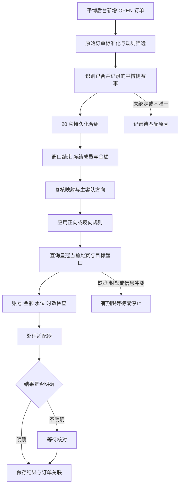

# 平博来单与皇冠跟单模块设计

更新日期：2026-11-03。状态：首版核心服务、队列、分类重试、只读核对、人工登记和跟单记录页已实现；真实资金成交未验证。下文保留完整设计依据，实际边界以本节为准。操作与排错见 [跟单执行与核对](FOLLOW_EXECUTION.md)。

目标是在 `HD-ps38P` 内独立完成“平博后台来单 → 20 秒订单合组 → 已确认赛事映射 → 皇冠实时盘口识别 → 规则处理 → 结果记录”。`hdproc` 与 `crown_market_lookup.py` 仅作为开发参考，新系统运行时使用自己的源码、数据库、账号池和会话。

## 当前实现与首版边界

- `ps38app/follow/` 已提供原单标准化、已保存映射识别、持久合组、规则、平台适配与可停止服务；任务库由 `follow_db_path`／`PS38_FOLLOW_DB` 配置，默认 `data/follow.sqlite3`。
- `#/copy` 已提供真实回执列表、处理中／未完成／待核对筛选、原单明细、规则表单和分页搜索。默认“已成功”仅展示明确成功且有票号的记录。
- 当前仅支持一条全局规则、一个皇冠目标账号、滚球足球单关全场／上半场让球与大小；可筛选来源会员。主客颠倒绑定、串关、角球和赛前订单会阻断并显示原因。
- 20 秒使用源下注时间作为固定窗口，按源赛事、玩法、方向、带符号盘口、时段、比分、人民币金额口径与规则版本合组。固定金额为每组一次整元金额；比例按合计金额乘百分比向下取整，不足 1 时跳过。
- 业务确认 PS38 后台 `THB` 是人民币金额的显示标签。源适配将 `THB`／`RMB`／`CNY` 统一按 `CNY` 原数字处理，不使用汇率；原始标签保存在 `reported_currency` 并显示在来源订单明细。规则币种输入已移除，兼容字段固定 `CNY`；皇冠账号真实币种仍按人民币核对。旧的已跳过、成功及未知任务保留原记录，不自动补发。
- 服务默认停用；页面明确保存并启用后开始消费新单。首次启用与暂停后重新启用均从当前事件位置开始；暂停时取消尚未在途的组，在途请求仍保存最终结果。
- 皇冠查盘区分比赛 GID 和盘口 GID，核对让球方、时段、比分、币种与会员报价；报价绑定账号／会话并在 5 秒内仅可使用一次。请求不自动接受水位变化。
- 即时回执须明确成功码 `560` 和有效票号；平台未回显金额／水位时保持为空。响应不明确或在途时中断进入 `UNKNOWN`，仅通过只读查询或人工核对登记解除，不允许重新提交未知请求。
- 有界执行器分离调度与网络等待，同账号最多一个任务。SQLite 占用同时约束组和账号，保护多实例与停止期间在途请求。一般查盘故障最多 6 次；缺盘等待仍受原单期限限制。已确认未发送的指定临时错误或明确无票号白名单拒绝可退避重查，每组最多 3 次提交尝试；金额、成员和规则保持冻结。
- 自动核对默认最多 5 次、120 秒；暂停规则仍继续核对已发请求。仅完整且唯一匹配的明确注单结果可确认成功，空集合、多候选及未知格式保持未知。未解决的未知请求阻止该账号后续提交，仍继续消费和合组新单。
- API 包含 `GET /api/follow`、`GET /api/follow/groups/<id>`、`POST /api/follow/rule`、`POST /api/follow/pause`，以及组级 `POST .../reconcile` 只读核对、`POST .../resolution` 人工登记。人工登记仅限无占用的未知组，成功须票号及依据，单独保留来源与审计，不能冒充即时回执；没有未知组重发入口。
- 本地测试使用临时库、模拟平台响应和本地 HTTP 服务；真实平台协议兼容性仍需依据实际脱敏回执持续核对。
- 准备阶段采用 10 秒共享预算，单次请求最多 5 秒，并在请求间、发送前及分块读取时检查停止信号。系统 DNS 解析和底层连接／响应头处理可能超出预算，无法保证严格墙钟内中断。服务先绑定 HTTP 端口再恢复跟单任务，重复启动失败不触碰在途记录。

第 2–11 节保留架构设计与参考代码核对过程，其中“建议”“拟定”属于设计背景；当前可用能力以上述实现边界、第 12 节与操作文档为准。自动核对使用保守字段契约；真实站点格式未经脱敏样本确认时保留未知，由人工核实并登记。

## 1. 已确认的业务规则

- 订单来自当前已接通的平博／PS38 后台。
- 按“赛事合并”中已经保存的赛事对应关系识别皇冠比赛。
- 正向跟单和反向跟单都支持，由规则配置选择。
- 符合条件的订单在 20 秒窗口内合成一组，以组为处理单位。
- 金额支持固定金额，或者按组内原单金额合计的一定比例计算。
- 先整理开发文档，再分阶段实施；首版已按上述边界落地。

首版选择参考代码中明确支持的滚球足球单关、全场／上半场让球与大小。赛前、特殊玩法和多账号分配作为后续扩展，不把旧系统的默认配置自动迁入本项目。

## 2. 实施前的能力与缺口

下表保留实施前的源码检查结果，作为设计依据；其中列出的缺口已有部分在首版补齐，见上方实现说明。该检查不代表对真实账号、实时盘口或实际提交接口的验证。

| 环节 | 当前证据 | 需要补齐的能力 |
| --- | --- | --- |
| 后台采集 | `Poller._poll_open()` 调用 `OrderStore.commit_snapshot()`，订单与新增事件在同一事务写入 | 独立消费新增事件，保存消费游标与处理任务 |
| 订单身份 | `partner_orders` 主键为 `(source, member_identity, order_id)`，保留完整 `raw_json` | 将原始玩法、时段、方向、盘口、比分、币种解析成明确的业务对象 |
| 20 秒归组 | `query_copy_groups()` 按同场、同玩法／方向／盘口／时段、同比分归组 | 持久组 ID、完整成员订单键、截止时间、冻结金额、迟到订单处理 |
| 赛事对应 | `league_mappings` 与 `fixture_mappings` 保存联赛及赛事绑定 | 后台来单身份到已绑定平博赛事的桥接，以及映射有效性检查 |
| 皇冠赛事 | `crown_fixtures.parse_games()` 保存 GID、LID、队名、时间等 | 保留或重新获取 `TEAM_H_ID`、`TEAM_C_ID`、`ECID` 等查盘身份字段 |
| 账号池 | `account_pool/` 已有登录、会话保存、在线状态和心跳 | 明确查盘账号与处理账号的职责，增加任务占用与结果关联 |
| 查询脚本 | 按 LID、主客队 ID 找比赛，再读取扩展盘口并打印参数 | 去掉旧源码和账号文件依赖，返回结构化结果，补全盘口语义校验 |
| 跟单页面 | 当前 `#/copy` 为能力说明；订单页另有“跟单视角” | 规则管理、合组倒计时、匹配过程、处理状态及失败原因 |
| 执行与核对 | 当前项目没有跟单执行、任务重试或结果核对模块 | 独立状态机、适配器边界、可恢复记录及本地模拟验证 |

主要证据入口：[订单存储](../ps38app/store.py)、[采集器](../ps38app/poller.py)、[赛事合并](../ps38app/fixture_merge.py)、[皇冠赛事](../ps38app/crown_fixtures.py)、[平博目录](../ps38app/pinnacle_fixtures.py)。

## 3. 整体数据流

跨平台队名差异由赛事合并层解决。来单处理层只消费已确认的对应关系；联赛绑定用于缩小范围，具体赛事绑定才用于确定这一场比赛。

## 4. 先接通订单与“已合并赛事”的身份

### 4.1 当前存在三类不同标识

| 标识 | 当前来源 | 使用约束 |
| --- | --- | --- |
| 后台订单赛事键 `p38_<时间>_<队名哈希>` | `ps38_event_id(event_ms, teams)` | 本项目生成，不能等同平台原生赛事 ID |
| 平博目录键 `pin:<原生ID>` | 官方目录，经 `fetch_pinnacle_events()` 转换 | 已合并列表主要使用此身份；`pinnacleId` 保留原生 ID |
| 皇冠比赛 ID | 皇冠列表 GID，保存到 `crown_event_id` | 标识比赛上下文，不保证等于半场或附加盘口使用的 GID |

兼容逻辑 `align_pinnacle_event_ids()` 可能保留历史已绑定 ID，并用 `catalogId` 保存新目录 ID。因此不能只凭 `ps38_event_id` 列名或 `pin:` 前缀推断所有历史记录的来源。

`_merge_event_sources()` 目前用联赛、五分钟时间桶和主客队给目录补充订单统计，没有保存订单赛事到官方赛事的关联。五分钟桶还可能把相差数秒、恰好跨桶的同场比赛分开，不能直接复用为处理条件。

### 4.2 拟采用的识别顺序

1. 从原始订单读取源赛事 ID（若确实存在）、联赛、主客队、真实开赛时间与赛事类别。
2. 若源赛事 ID 存在，先验证它与平博目录原生 ID 是否属于同一体系，再通过显式别名关联已绑定记录；ID 冲突时记录冲突，不静默退回队名猜测。
3. 若没有可用共同 ID，仅在已绑定记录的**平博侧快照**中核对联赛、主队、客队、开赛时间及类别，要求唯一命中。模糊相似度只能生成待确认候选。
4. 确认相应联赛绑定仍存在，读取对应皇冠身份与主客方向，保存关联依据和映射版本。
5. 零匹配进入待匹配；多匹配进入待核对。两者都不能随意选第一场。

代码和现有测试样本尚不能证明后台真实订单一定包含 `eventId`。首阶段应通过脱敏样本核实字段契约。订单展示允许在缺少开赛时间时退回下注时间，但业务识别不应把 `created_ms` 当成开赛时间。

建议增加显式的身份关联记录，保存源标识的命名空间、原生 ID／身份指纹、对应映射键、匹配依据、映射版本和更新时间。旧映射缺字段时标记为“待补充”，通过重新获取赛事并核对身份补齐，保留现有绑定。

### 4.3 皇冠身份应保留什么

映射快照或其关联的身份记录应保留皇冠 `LID`、`TEAM_H_ID`、`TEAM_C_ID`、比赛 GID、`ECID`、主客队、开赛时间、赛前／滚球状态和采集时间。字段缺失不能用队名或内部联赛键冒充平台 ID。

用户脚本实际使用的是**联赛 ID + 主队 ID + 客队 ID**，并非仅传入主客队名字。实施前 `parse_games()` 和 `prepare_crown_event()` 未完整传递两个队伍 ID 与 ECID；首版已补齐解析和快照链路。历史绑定缺少球队 ID 时，只能通过原皇冠 GID、联赛、同平台主客队名与开赛时间唯一命中最新赛事，再读取真实球队 ID；无法唯一核实时提示刷新已合并赛事，不能虚构平台 ID。

同一联赛的同两支球队可能多次交手，上述三项也不应跨日期长期充当唯一赛事身份。识别时同时核对开赛时间、比赛类别与当前状态。比赛切换滚球或接口 ID 变化时，重新验证目标，不直接沿用失效盘口 ID。

## 5. 20 秒合组必须成为持久化业务

### 5.1 拟定分组条件

在规则筛选和源单去重之后，按以下业务条件归组：同一规则及其版本、同一已识别源赛事、同一比赛类别、同一赛前／滚球状态、同一时段、同一玩法、同一方向、同一规范化盘口、同一比分、同一币种。

不同会员可以进入同一组，前提是都属于该规则允许的来源范围。不同规则、方向或比分必须分开。源单先进行人民币标签规范化，THB／CNY／RMB 标签差异不会拆组或跳过；其他未确认币种不能擅自换算。滚球比分缺失、盘口无法解析等情况进入待核对，不能把缺失值当作 0。

建议保留现有展示的时间口径：以源单 `created_ms` 为准，同组订单距首单不超过 20 秒。窗口固定，后续订单不会延长它；窗口时间口径仍需业务确认。

例如，同条件订单在 12:00:00、12:00:08、12:00:19 到达所属源时间窗口，原单金额分别为 100、200、300，形成总额 600 的一组；12:00:21 的新单进入下一组。这里的时间指源订单时间，并不假设采集无延迟。

### 5.2 生命周期与迟到处理

- 第一笔有效订单创建组，立即持久化 `group_id`、首单时间、截止时间和规则快照。
- 新成员加入与成员唯一键检查、组金额更新、消费游标推进在同一任务库事务内完成。
- 处理一批已读取的事件后再判断窗口关闭，避免同批订单因遍历顺序被错误拆开；使用明确的时间与迟到处理策略。
- 到期后冻结组成员、总额、目标方向和金额，随后进行最新盘口核验。
- 冻结后的组不能因为页面刷新、重启或后续迟到订单而修改已处理金额。
- 建议首版将落入已冻结窗口的迟到订单记录为 `LATE_ORDER` 待核对；是否允许组成补充组属于业务选项，不能隐式补处理。
- 重启后恢复尚在窗口内的组；对过期组重新检查源单年龄及最新状态，不能无条件把积压组全部处理。
- 改规则只影响新组；已经形成的组保留规则版本。成员订单结算、撤销或数据修正时，在冻结与处理前复核，按明确规则终止或重新形成尚未处理的组。

现有 `query_copy_groups()` 每次按查询范围重新计算，没有稳定组 ID、完整成员键和持久状态，也没有把规则、币种、赛前／滚球全部作为业务分组边界。未来跟单页应读取持久化分组，当前展示查询可继续用于统计。

### 5.3 新单来源与恢复

复用 `partner_order_events` 作为增量来源。它仅在非首轮 OPEN 快照出现新的 OPEN 订单时生成；首次基线、历史补采和普通订单更新都不会生成新单事件。

任务服务应有独立持久化游标。当前页面事件查询在没有游标时跳到最新位置，并且事件只保留最近 5000 条；任务服务不能原样照搬这一消费语义。发生游标缺口时先记录缺口并暂停受影响的消费，再按启用时间、源单时效与成员去重记录进行有界恢复，不能自动重放全部历史订单。

订单库与拟新增任务库之间采用可重复读取、幂等写入：先读取已提交事件，再在任务库一个事务内保存成员／组变化及新游标。崩溃后重复读取由唯一约束吸收。首次启用建议从明确记录的启用游标开始；停机恢复使用已保存游标。

## 6. 正向、反向与主客队顺序

统一意图至少包括：源订单键、源赛事身份、比赛类别、`period`、`market_type`、`side`、带符号盘口线、`is_live`、比分、金额、币种、源赔率及赔率制式、源时间、原始内容指纹。

让球线统一定义为**所选球队的让球值**：负数代表所选球队让球，正数代表受让。适配平博原始字段时必须用脱敏样本验证这一约定，不直接把未经确认的原始数值当成规范值。

| 源意图 | 正向目标 | 反向目标 |
| --- | --- | --- |
| 主队 -0.5 | 同一球队 -0.5 | 对方球队 +0.5 |
| 客队 +0.25 | 同一球队 +0.25 | 对方球队 -0.25 |
| 大 2.5 | 大 2.5 | 小 2.5 |
| 小 2.75 | 小 2.75 | 大 2.75 |

反向只在一个策略入口计算一次，并保存源意图和目标意图。全场／半场、进球／角球、赛前／滚球等维度不会因为反向而改变。

`reversedOrder` 表示两个平台排列主客队的顺序不同，与反向跟单配置是两个概念。先根据球队身份把源选择和比分转换到皇冠排列，再应用业务方向规则；方向不同不等于单纯翻转盘口符号。大小方向不受主客顺序影响。

当前人工绑定路径在缺少候选信息时可能把 `reversedOrder` 保存为 `False`，因此不能只信任这个布尔值。身份或方向证据不完整时先待核对。旧 `reverse_pipeline.resolve_fixture()` 直接排除主客颠倒的绑定，其限制不能被误认为已实现了颠倒转换。

## 7. 查询脚本如何改成独立模块

参考脚本 `crown_market_lookup.py` 当前流程是：读取旧账号文件 → 查滚球比赛列表 → 按三个 ID 找唯一比赛 → 查询扩展盘口 → 筛选全场／半场让球或大小 → 打印参数。它没有实际提交行为。

需要做以下适配：

1. 把盘口编解码与解析逻辑复制、整理进本项目；移除 `sys.path` 注入和 `hdzz` 导入。
2. 从本项目账号池获取会话引用，通过服务端适配器使用；移除外置硬盘路径和旧 `arsenal.json` 读取。
3. 把命令行参数、`print` 和 `sys.exit` 改为明确的输入对象、返回对象与分类错误；不通过解析终端输出衔接业务。
4. 由已确认的皇冠身份定位当前比赛，再读取对应时段和玩法。脚本目前写死滚球；若支持赛前，需要独立完成赛前数据路径及测试。
5. 返回比赛 ID 与实际盘口行 GID，两者分开；同时返回玩法、方向、带符号盘口、赔率制式、水位、比分、封盘状态、账号引用与获取时间。
6. 对每个候选核对时段、玩法、比赛类别、主客身份、让球方、盘口线和有效水位。零匹配、多匹配和字段缺失分别记录原因。

脚本 `normalize_line()` 把盘口各段取绝对值。它可用于筛选数值幅度，但不能独立证明“主队让 0.5”和“主队受让 0.5”一致。之后对自行生成的编码做解码校验，也不能替代对实际盘口让球方的验证。

皇冠 H／C 字母在让球和大小中的含义不同，应只存在于平台适配器中；业务层使用 HOME／AWAY／OVER／UNDER。金额与盘口计算建议使用十进制定点数或四分之一单位，避免浮点近似及非法数值被默认为零。

水位来自当前账号、当前盘口和当前时间。源赔率与皇冠水位必须标明制式；不能把不同制式的数字直接比较。金额计算完成或发生等待之后，应检查报价是否过期；换账号时重新核对该账号的报价及处理上下文。

## 8. 金额、账号与处理状态

### 8.1 金额以组为单位

| 模式 | 拟定语义 | 示例 |
| --- | --- | --- |
| 固定金额 | 每个冻结组使用配置金额一次 | 组内有 3 笔原单，配置 100，则组目标金额为 100 |
| 比例金额 | 对组内有效原单金额合计乘以比例 | 原单合计 600，比例 10%，则组目标金额为 60 |

当前固定金额以每个冻结组计一次，使用单个账号，不拆单；比例金额向下取整为整元，THB／RMB／CNY 按已确认的人民币口径合计。平台回显最低／最高金额时，提交前核对范围；累计限额和多账号策略仍属于后续范围。

### 8.2 状态与约束

| 状态 | 含义 | 后续行为 |
| --- | --- | --- |
| `WAIT_MAPPING` | 源赛事未唯一关联已合并记录 | 有期限等待映射补齐，仍受原始时间窗口约束 |
| `GROUPING` | 20 秒窗口内收集成员 | 去重加入，更新未冻结总额 |
| `READY` | 窗口结束且组已冻结 | 复核源单、映射、规则、金额和账号 |
| `WAIT_MARKET` | 目标线缺失、封盘或只读查询暂时失败 | 截止时间内有界重查 |
| `PREPARING` | 已领取账号占用，正在只读核验盘口 | 未提交的失效占用可恢复查盘 |
| `RETRY_WAIT` | 明确可恢复的拒绝或未发送故障 | 保留冻结内容，退避后重新准备 |
| `SUBMITTING` | 一次处理尝试已持久化且在途 | 同一任务不得同时发起另一次 |
| `SUCCEEDED` | 已获得可核验的明确成功结果 | 保存回执与原组关联 |
| `REJECTED` | 获得不可恢复拒绝、重试耗尽或人工确认未成交 | 保存原因并结束 |
| `UNKNOWN` | 请求可能已被接收，但响应丢失或进程中断 | 仅核对，不能直接重试提交或换号重做 |
| `EXPIRED`／`SKIPPED` | 超时或不符合范围 | 保存原因，不自动追处理 |

待映射订单需先持久保存；映射补齐后按原始源单时间进入合组流程，不能把补齐时间当作新订单时间。

当前仅使用一个明确配置的目标账号。组内成员、金额、账号与每次提交尝试均持久保存；状态 `PREPARED` 只作为旧记录兼容值，新流程使用 `PREPARING`。

当前没有证据证明皇冠提供可由本项目使用的服务端幂等键，因此不能承诺网络故障下严格只处理一次。通过本地唯一约束、在途任务锁和未知结果核对降低重复风险；长期无法核实的结果保持待核对。

结果核对应包含账号、比赛、时段、玩法、方向、盘口、金额、时间及可用回执标识，多个候选时维持未知状态。`hdproc` 的旧核对仅按较少字段匹配并取最近候选，不能照搬为新系统的成功依据。

## 9. 独立模块与数据边界

当前模块结构如下；合组调度放在 `service.py`，没有额外的 `grouping.py`：

| 位置 | 职责 |
| --- | --- |
| `ps38app/follow/source.py` | 原始平博订单适配、范围检查与标准意图 |
| `ps38app/follow/mapping.py` | 读取已绑定映射，建立源身份桥接及验证方向 |
| `ps38app/follow/service.py` 的合组流程 | 20 秒窗口、成员去重、冻结及迟到处理 |
| `ps38app/follow/rules.py` | 正反向变换、金额模式、时效及限制 |
| `ps38app/follow/crown.py` | 皇冠查盘、账号上下文和处理适配边界 |
| `ps38app/follow/crown_markets.py` | 盘口解析、半场 ID、回显核对与回执解析 |
| `ps38app/follow/dispatcher.py` | 有界网络执行、组键去重、同账号串行与完成回收 |
| `ps38app/follow/reconcile.py` | 完整注单响应的严格纯解析、唯一匹配核对 |
| `ps38app/follow/store.py` | 规则、游标、组、成员、尝试、账号占用、历史与核对审计 |
| `ps38app/follow/service.py` | 工作线程生命周期、有界调度、停止与恢复 |
| `web/modules/copy/` | 规则、持久化分组、处理过程和结果页面 |
| `tests/test_follow_*.py` | 临时数据库、本地服务与模拟响应回归 |

建议新增独立任务库，路径由配置解析；现有订单库与映射库保持兼容。任务库至少记录规则版本、消费游标、身份关联、组、组成员、处理尝试、结果和状态变更。

成员记录使用完整源单键。对同一逻辑规则，一笔源单只能归入一个业务组；编辑规则版本不能让已经消费的订单再次入组。`group_id` 在创建时固定，任务尝试关联同一个组；如果未来允许分配给多个账号，再建立明确的分配子任务及唯一约束。

采集器只负责采集和提交订单；跟单服务独立消费，查盘等待不得阻塞 OPEN 轮询。HTTP 层调用服务，不直接操作浏览器。每个线程自行持有并关闭 SQLite 连接，事务明确提交／回滚；停止时释放线程、网络连接与任务占用，并保留未完成状态。

账号凭证与 Cookie 只留在当前账号池，任务记录保存账号 ID 与脱敏上下文。源码不引用旧项目绝对路径，不读取旧运行目录，不调用旧 WebUI 私有接口，不用 JSONL 文件作为跨项目桥梁。

## 10. 从 hdproc 参考哪些代码

旧仓库位置为 `/Volumes/zsc5200xx/hdproc/`，下表路径均相对于该仓库，仅供开发时查阅。

| 参考位置 | 可参考内容 | 必须适配的部分 |
| --- | --- | --- |
| `ps3838/reverse_pipeline.py`：`source_intent()`、`resolve_fixture()`、`opposite_intent()` | 平博字段标准化、消费已确认映射、方向规则 | 当前库字段与 ID 体系；正向分支；主客顺序；时间及玩法范围 |
| 同文件 `probe_market()` | 精确盘口、比分与状态核验边界 | 旧 WebUI 私有方法、旧快照服务、账号文件与路径依赖 |
| `src/hdzz/core/follower/strategy.py` | 盘口编解码及四分之一盘口处理 | 新标准意图与明确的符号约定，保留可适用测试 |
| 同目录 `market_rows.py` | 结构化盘口行、比赛与盘口 GID 分离 | 实际响应结构及账号报价绑定 |
| 同目录 `models.py`、`retry_scheduler.py`、`attempt_dispatcher.py` | 在途约束、有期限等待、未知结果状态 | 持久化改为本项目 SQLite，并接本地生命周期 |
| 同目录 `engine.py` | 金额模式、账号资格过滤和整体状态划分 | 只抽取职责清晰的逻辑；不复制整个主循环及历史依赖 |
| 同目录 `reconcile.py` | 未知结果优先核对的思路 | 扩大核对指纹，多候选不能直接认定成功 |

旧 `local_signal_push.py` 通过 `_internal_order()`、`_write_order()` 构造旧引擎格式并写 JSONL；新系统直接使用内部标准对象与任务库，不需要伪造旧 AG 来单再重复解析。旧引擎对平博信号“已经反向”的要求与固定 120 秒时效，也不能原样作为本项目规则。

## 11. 实施顺序与验收

| 阶段 | 可交付结果 | 验收依据 |
| --- | --- | --- |
| 1. 身份与原始字段 | 脱敏字段契约、来单到已合并赛事的关联、皇冠查盘 ID 补齐 | 同场唯一命中；缺失、冲突、重复与跨日期样本明确阻断 |
| 2. 持久化合组与规则 | 20 秒组、完整成员、冻结、双方向与两种金额模式 | 同单多次收到只入组一次；边界、重启、迟到、不同币种可解释 |
| 3. 只读盘口识别 | 独立查询模块，跟单页显示组的源意图、目标赛事及盘口 | 全场／半场、让球／大小、正负盘口和主客顺序均有模拟样本 |
| 4. 本地模拟全链路 | 服务、状态机、结果与恢复流程 | 成功、拒绝、封盘、超时、未知结果、退出重启均可回放 |
| 5. 平台适配评估 | 在明确业务边界后核对平台接口契约、账号与结果语义 | 报价有效性、回执解析与未知结果处理有独立证据；不能用打印参数成功替代验收 |

每阶段按职责小步修改，保持 `python run.py` 和现有双击启动入口。测试使用临时目录与 `tests.support.isolated_config()`，不读取个人配置或写项目 `data/`。开发依赖安装到项目 `.venv`。

交付前执行 `python scripts/check.py`；改动页面交互、登录或会话时再执行 `python scripts/check.py --browser`。独立性验收需在不挂载旧硬盘、不设置旧源码路径的情况下完成启动和本地模拟回归。

必须覆盖的场景包括：首次基线与历史补采不误触发；事件游标缺口；同会员同单与不同会员同号；20 秒边界；同场比分变化；源单结算或修正；规则变更；映射解绑与 ID 变更；让球正负与主客颠倒；半场误选全场；封盘或多盘口；不同赔率制式；处理过程中退出；未知结果禁止再次提交。

2026-11-03 队列与核对闭环验收：`python scripts/check.py` 运行 281 项，其中 15 项浏览器回归按默认配置跳过，其余通过；`python scripts/check.py --browser` 的 281 项全部通过，Ruff 检查通过。测试覆盖有界网络任务、同账号占用、多实例竞争、分类退避与次数上限、未知结果账号门禁、状态恢复、核对调度公平性及人工请求竞态、Windows 只读进程查询、人工登记与迟到响应隔离；组合测试验证提交响应丢失后只读核对成功，下注写请求总共只有一次。页面回归覆盖新状态、审计、校验、防重复、输入保留、关闭重开及移动端。原有 THB 人民币口径与其他模块回归继续通过。本地模拟通过不等同于真实平台成交验证，真实今日注单响应格式仍需脱敏样本核对。

## 12. 首版取值与后续业务选项

| 事项 | 当前状态／建议 |
| --- | --- |
| 时间窗口 | 20 秒，首版使用源下注时间；落入已冻结窗口的迟到单跳过并记录原因 |
| 可处理时效 | 页面可设 21–600 秒，默认 120 秒，包含合组和查盘等待 |
| 玩法范围 | 足球单关全场／上半场让球与大小；角球、串关等需另行扩展 |
| 赛前／滚球 | 首版只支持滚球；赛前后续单独实现 |
| 来源筛选与规则冲突 | 首版支持会员筛选与一条全局规则；多规则冲突策略留待扩展 |
| 账号分配 | 首版每组使用一个配置账号；轮换、拆分与多账号分配留待扩展 |
| 金额细节 | 页面填写固定人民币金额／百分比；THB 原数字按人民币，保留原标签；整元，比例向下取整，不换汇 |
| 水位与比赛变化 | 页面支持香港盘最低／最高水位；报价 5 秒有效，比分与目标线不一致时不处理 |
| 迟到与恢复 | 未知结果保持待核对；事件缺口暂停，重新启用不静默重放停用期间订单 |

返回 [开发说明](DEVELOPMENT.md) 或 [模块职责](ARCHITECTURE.md)。
